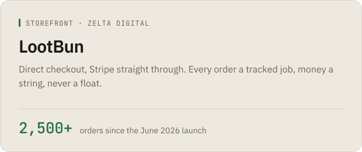
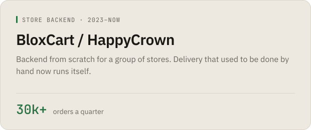
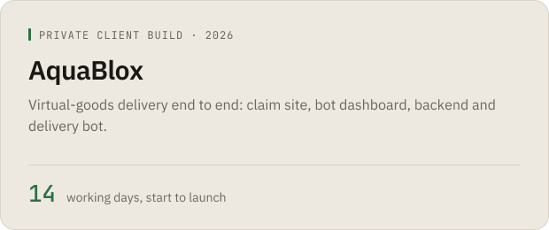
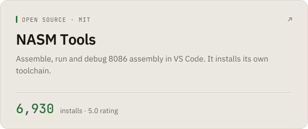
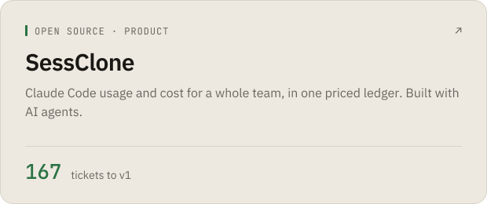
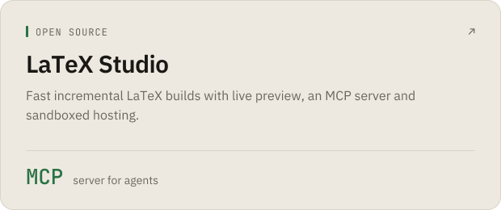

<picture><source media="(prefers-color-scheme: dark)" srcset="./assets/header-dark.svg"></picture>

  <samp>
    <a href="https://tahaali.dev">site</a> ·
    <a href="mailto:hi@tahaali.dev">hi@tahaali.dev</a> ·
    <a href="https://linkedin.com/in/NotTahaAli">linkedin</a>
  </samp>

I'm Taha. I see how it breaks first, then I build the version that doesn't. Six years of systems people pay through; CS at FAST NUCES, Lahore (3.92 CGPA).

<picture><source media="(prefers-color-scheme: dark)" srcset="./assets/div-01-dark.svg"></picture>

  <picture><source media="(prefers-color-scheme: dark)" srcset="./assets/card-lootbun-dark.svg"></picture>
  <picture><source media="(prefers-color-scheme: dark)" srcset="./assets/card-happycrown-dark.svg"></picture>

  <picture><source media="(prefers-color-scheme: dark)" srcset="./assets/card-aquablox-dark.svg"></picture>
  <a href="https://github.com/NotTahaAli/NASM-Tools"><picture><source media="(prefers-color-scheme: dark)" srcset="./assets/card-nasm-tools-dark.svg"></picture></a>

  <a href="https://github.com/NotTahaAli/sessclone"><picture><source media="(prefers-color-scheme: dark)" srcset="./assets/card-sessclone-dark.svg"></picture></a>
  <a href="https://github.com/NotTahaAli/LatexPipeline"><picture><source media="(prefers-color-scheme: dark)" srcset="./assets/card-latex-studio-dark.svg"></picture></a>

Also: [Roblox Account Manager SDK](https://github.com/NotTahaAli/RobloxAccountManagerSDK), typed async Python, 22 endpoints.

<picture><source media="(prefers-color-scheme: dark)" srcset="./assets/div-02-dark.svg"></picture>

**Hiring** a backend-first product engineer · **building something** that has to work the first time · **running a business** that still does by hand what a system should → [hi@tahaali.dev](mailto:hi@tahaali.dev)

TypeScript · Node · Next.js · Fastify · Python · Lua · PostgreSQL · Supabase · Stripe · Shopify · Linux · Claude Code
